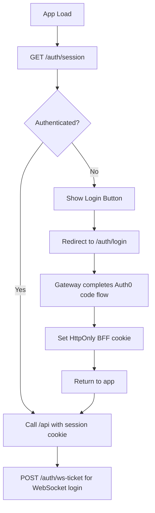

# trad-web-client

The Vue 3 + Vite browser client for trad.lol. Start with
[AGENTS.md](AGENTS.md). Plans, budgets and architecture live in the backend
repository's `docs/` (`plan.md`, `architecture.md`,
`networking-2026-10.md`); product and design principles are in
[PRODUCT.md](PRODUCT.md).

## Project Setup

```sh
bun install
```

### Compile and Hot-Reload for Development

```sh
bun dev
```

### API proxy and BFF auth

During development, `/api/*` and `/auth/*` are proxied to `VITE_API_TARGET` (default `http://localhost:8080`). WebSocket requests to `/ws` are proxied to `VITE_WS_TARGET` (default `ws://localhost:8081`). Local values should live in `.env.local`.

The browser uses the gateway BFF session cookie for HTTP requests. Auth0 configuration and secrets belong in the gateway environment, not in browser-exposed `VITE_*` variables. WebSocket authentication uses a short-lived BFF ticket from `/auth/ws-ticket`.

Env variables:

- `VITE_API_BASE` (prod base URL for API; defaults to `/api`)
- `VITE_API_TARGET` (dev proxy target; defaults to `http://localhost:8080`)
- `VITE_WS_URL` (optional explicit WebSocket URL; blank derives `/ws` from the current origin)
- `VITE_WS_TARGET` (dev proxy target; defaults to `ws://localhost:8081`)

Example usage:

```ts
import { apiGet, apiPost } from '@/lib/apiClient'

// GET /api/health (in dev) or `${VITE_API_BASE}/health` in prod
const health = await apiGet<{ ok: boolean }>('/health')

// POST to /api/orders
const order = await apiPost('/orders', { symbol: 'BTCUSD', side: 'buy' })
```

### Authentication flow

This app uses the gateway as a BFF. The browser never stores Auth0 access tokens; it redirects to `/auth/login`, receives an HttpOnly session cookie from the gateway, and calls authenticated HTTP routes with `credentials: include`.



### Type-Check, Compile and Minify for Production

```sh
bun run build
```

### Lint with ESLint

```sh
bun lint
```

## Styling Architecture

### Design Tokens

Centralized in `src/assets/tokens.css` using a Tailwind v4 `@theme` block plus dark-mode overrides. Component styles import this first (`main.css`). This separation allows:

- Faster theming / brand iteration
- Potential runtime token swapping (theme packs)
- Clear diff history for purely visual changes

### Components & Utilities

`src/assets/main.css` houses consolidated component classes (`@layer components`). No `@extend` tricks; everything is standard Tailwind utilities + CSS variables. This keeps the CSS pipeline predictable and avoids plugin lock‑in.

### Purge / Safelist Strategy

Dynamic class names in Vue templates (e.g. `:class="['btn', variant]"`) may not be statically discoverable. We enumerate likely dynamic classes under `safelist` in `tailwind.config.js`.

Guidelines:

1. Prefer explicit full class literals when feasible.
2. When constructing variants programmatically, update `safelist` (or convert a group to a regex like `/^pill-(ok|err|warn|info)$/`).
3. Audit build size periodically: `grep -c ".btn-" dist/assets/*.css` (rough heuristic) to ensure variants are preserved.

### Future: Plugin / Mixins Extraction

If we introduce a custom Tailwind plugin, repeated button variant patterns can collapse into a `btn-base` component and color recipes:

```js
// Example (not yet enabled):
export function buttonVariantsPlugin({ addComponents }) {
    addComponents({
        '.btn-base': {
            '@apply inline-flex items-center gap-1 rounded border px-2 py-1 text-[12px] font-medium tracking-[0.5px] transition cursor-pointer disabled:cursor-not-allowed disabled:opacity-50': {}
        }
    });
}
```

Then each variant becomes:

```css
.btn-primary { @apply btn-base border-term-accent/40 bg-term-accent/20 text-term-accent hover:border-term-accent hover:bg-term-accent/30; }
```

The actual implementation now lives as a modular plugin: `tailwind.plugins/buttonVariants.js` and is imported in `tailwind.config.js`.

### Button Variants Plugin Options

The plugin is palette‑driven and can be customized by constructing it with `createButtonVariantsPlugin` instead of importing the default instance.

```js
// tailwind.config.js
import { createButtonVariantsPlugin } from './tailwind.plugins/buttonVariants.js'

export default {
    // ...
    plugins: [
        createButtonVariantsPlugin({
            palette: [
                { name: 'primary', color: 'var(--color-term-accent)', kind: 'accent' },
                { name: 'neutral', color: 'rgba(71,85,105,0.6)', kind: 'neutral' },
                { name: 'danger', color: '#ef4444', kind: 'tone' },
                { name: 'success', color: '#10b981', kind: 'tone' },
                // Add a custom info tone
                { name: 'info', color: '#3b82f6', kind: 'tone' },
            ],
            dataAttributeMode: true,  // enables [data-variant="danger"] mapping
            aliases: true,            // keeps .btn-primary / .btn-secondary legacy classes
        }),
    ],
}
```

#### Palette Entries

Each palette item: `{ name, color, kind }` where:

- `name`: becomes part of the class e.g. `.btn-{name}`, `.btn-outline-{name}`, `.btn-ghost-{name}`.
- `color`: hex (`#10b981`), rgb/rgba, or CSS variable (`var(--accent-color)`).
- `kind`: select recipe
        - `accent`: subtle tinted background + stronger hover & pressed states
        - `neutral`: low‑contrast neutral styling with hover tint
        - `tone` (default): colored border + tinted fill + contrast‑aware text color

#### Data Attribute Mode

When `dataAttributeMode` is `true` you can style with attributes instead of classes:

```html
<button class="btn" data-variant="primary">Primary</button>
<button class="btn" data-variant="outline-danger">Delete</button>
<button class="btn" data-variant="ghost-success">OK</button>
```

Attribute mapping exists alongside the traditional classes so either approach works. This can help reduce class switching noise in components that change only the variant value.

#### Disabled & Focus Styles

Disabled buttons remove gradients and drop shadows, relying on neutral panel bg + dim text for better clarity. Focus rings adopt the variant color (for outline/ghost as well) to preserve contextual meaning.

#### Extending Further

You can wrap the exported `createButtonVariantsPlugin` in your own factory that injects a project‑wide augmented palette or adds additional kinds (e.g. `warning`, `info`) by cloning one of the existing recipe helpers.

```js
// example extension (in a local file)
import { createButtonVariantsPlugin } from './tailwind.plugins/buttonVariants.js'
export const extendedButtons = createButtonVariantsPlugin({
    palette: [
        { name: 'primary', color: 'var(--color-term-accent)', kind: 'accent' },
        { name: 'neutral', color: 'rgba(71,85,105,0.6)', kind: 'neutral' },
        { name: 'danger', color: '#ef4444', kind: 'tone' },
        { name: 'success', color: '#10b981', kind: 'tone' },
        { name: 'warning', color: '#f59e0b', kind: 'tone' },
    ],
})
```

If you add many dynamic names remember to update (or regex‑ify) the `safelist` to prevent purging.

### Style Guide

The route `/style-guide` provides a simple visual surface enumerating buttons, inputs, pills, notices, and badges for manual QA and potential screenshot regression tooling.

### Theming

Dark mode toggled via `[data-theme="dark"]` on the root. Tokens cascade automatically—no JS beyond the attribute switch. Additional themes can be added by scoping another attribute or data value and overriding only differing tokens.

### Token Consumption in JS

If charting or other libs need colors, you can read them with:

```ts
const root = getComputedStyle(document.documentElement)
const accent = root.getPropertyValue('--accent-color').trim()
```

Consider creating a small helper module (`src/lib/themeTokens.ts`) if usage grows.

---
Open to further refactors: splitting tokens by domain (`color`, `spacing`, etc.), or adding semantic alias tokens (e.g. `--color-surface`, `--color-outline-strong`).
